# Jarkom-Modul-3-2026-K-22

> 11. Utahime dan Shoko ditugaskan membangun sistem penamaan domain resmi agar seluruh pos tidak perlu menghafal alamat IP mentah. Konfigurasikan BIND9 pada utahime sebagai DNS Master dan shoko sebagai DNS Slave untuk mengelola domain jujutsu.<xxxx>.com. Atur SOA record, NS delegasi untuk kedua server, dan terapkan allow-transfer dari Master ke Slave. Pastikan file zona berhasil tersinkronisasi otomatis ke shoko saat nomor serial di utahime dinaikkan, lalu buktikan dengan melakukan query dig ke kedua server dari salah satu client.

Disini, kami melakukan konfigurasi DNS menggunakan BIND9 dengan menerapkan arsitektur Master-Slave pada domain `jujutsu.K22.com`. Node Utahime berperan sebagai DNS Master yang menyimpan dan mengelola *zone file*, sedangkan node Shoko berperan sebagai DNS Slave yang menerima salinan zona dari Utahime melalui mekanisme *zone transfer*. Konfigurasi dilakukan menggunakan shell script pada masing-masing node untuk mempermudah proses instalasi, pengaturan jaringan, serta validasi layanan DNS.

**1. Konfigurasi DNS Master (Utahime)**

Alur konfigurasi pada Utahime adalah sebagai berikut:

1. **Konfigurasi Jaringan**  
   Script mengatur interface `eth0` menggunakan alamat IP statis `192.222.1.2/24` dan menetapkan `192.222.1.1` sebagai *default gateway*. Pengaturan ini memastikan Utahime dapat berkomunikasi dengan node lain pada Network 1.

2. **Instalasi BIND9**  
   Script memperbarui daftar paket dan menginstal `bind9`, `bind9-utils`, serta `bind9-dnsutils` sebagai layanan DNS dan perangkat bantu untuk validasi maupun pengujian query DNS.

3. **Konfigurasi DNS Master**  
   File `/etc/bind/named.conf.local` dikonfigurasi untuk mendefinisikan `jujutsu.K22.com` sebagai *Master Zone*. Pada konfigurasi tersebut, alamat IP Shoko (`192.222.1.3`) ditetapkan sebagai server yang diizinkan menerima transfer zona melalui `allow-transfer`. Selain itu, `also-notify` dan `notify yes` digunakan agar perubahan zona dapat diberitahukan kepada DNS Slave.

4. **Pembuatan Zone File**  
   Script membuat file `/etc/bind/db.jujutsu.K22.com` yang berisi SOA record, NS record, serta A record untuk nameserver `ns1` dan `ns2`. SOA record memuat informasi otoritatif zona, termasuk nomor serial yang digunakan untuk mengidentifikasi versi zona. Nomor serial akan dinaikkan apabila konfigurasi sebelumnya sudah memiliki serial yang valid.

5. **Validasi dan Penerapan Konfigurasi**  
   Konfigurasi diperiksa menggunakan `named-checkconf` untuk memvalidasi konfigurasi BIND9 secara keseluruhan dan `named-checkzone` untuk memeriksa isi zona. Setelah validasi, layanan BIND9 dijalankan atau di-*reload* agar konfigurasi terbaru diterapkan.

6. **Pengujian DNS Master**  
   Script menjalankan perintah `dig` untuk memeriksa SOA dan NS record dari Utahime. Pengujian ini digunakan untuk memastikan bahwa DNS Master dapat memberikan informasi zona yang telah dikonfigurasi.

Scriptnya [setup-dns-master_11.sh](nodes/switch1/utahime/setup-dns-master_11.sh)

**2. Konfigurasi DNS Slave (Shoko)**

Alur konfigurasi pada Shoko adalah sebagai berikut:

1. **Konfigurasi Jaringan dan Instalasi BIND9**  
   Script mengatur interface `eth0` menggunakan alamat IP statis `192.222.1.3/24` dan menetapkan `192.222.1.1` sebagai *default gateway*. Selanjutnya, script memperbarui daftar paket dan menginstal BIND9 beserta perangkat bantu DNS.

2. **Konfigurasi DNS Slave**  
   File `/etc/bind/named.conf.local` dikonfigurasi untuk mendefinisikan `jujutsu.K22.com` sebagai *Secondary Zone*. Alamat IP Utahime (`192.222.1.2`) ditetapkan sebagai *primary server* melalui parameter `primaries`. Dengan konfigurasi ini, Shoko mengambil salinan zona dari Utahime tanpa perlu membuat ulang seluruh record secara manual.

3. **Persiapan Direktori Zona**  
   Script menyiapkan direktori `/var/cache/bind` sebagai lokasi penyimpanan salinan zona dan memberikan kepemilikan direktori kepada pengguna `bind`. Direktori tersebut digunakan oleh BIND9 untuk menyimpan data zona sekunder.

4. **Validasi dan Menjalankan Layanan**  
   Konfigurasi diperiksa menggunakan `named-checkconf`. Setelah itu, direktori runtime `/run/named` disiapkan dan proses BIND9 dijalankan menggunakan konfigurasi yang telah dibuat.

5. **Pengujian DNS Slave**  
   Script menjalankan `dig` terhadap alamat IP Shoko untuk memeriksa SOA dan NS record domain `jujutsu.K22.com`. Pengujian ini digunakan untuk memastikan bahwa Shoko dapat memberikan jawaban DNS untuk zona yang dikelolanya.

Scriptnya [setup-dns-slave_11.sh](nodes/switch1/shoko/setup-dns-master_11.sh)

**3. Pengujian Sinkronisasi Zona Master-Slave**

Setelah kedua server dikonfigurasi, dilakukan pengujian untuk memastikan bahwa perubahan nomor serial pada Utahime dapat disinkronisasikan ke Shoko. Pada Utahime, nomor serial di dalam SOA record diubah dari `2026101401` menjadi `2026101402`. Selanjutnya, zona divalidasi kembali menggunakan `named-checkzone`, kemudian layanan BIND9 diberi sinyal *reload* agar perubahan diterapkan.

Perintah yang digunakan pada Utahime adalah sebagai berikut:

```bash
sed -i 's/2026101401/2026101402/' /etc/bind/db.jujutsu.K22.com
named-checkzone jujutsu.K22.com /etc/bind/db.jujutsu.K22.com
kill -HUP "$(pgrep -xo named)"
```

Setelah perubahan diterapkan, query SOA dilakukan pada kedua server menggunakan perintah berikut:

```bash
dig @192.222.1.2 jujutsu.K22.com SOA +short
dig @192.222.1.3 jujutsu.K22.com SOA +short
```

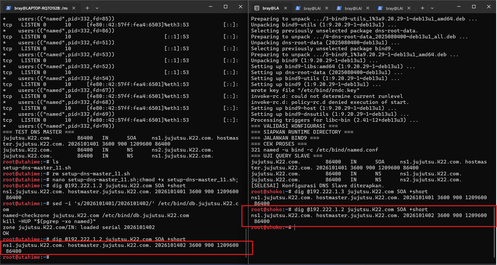

Apabila kedua server menampilkan nomor serial `2026101402`, hal tersebut menunjukkan bahwa Shoko telah menerima versi zona terbaru dari Utahime. Dengan demikian, mekanisme sinkronisasi zona DNS Master-Slave dapat diverifikasi melalui kesamaan informasi SOA yang diberikan oleh kedua server.

---

> 12. Peta domain harus memetakan pintu masuk utama dan tetap bisa mencari alamat di luar kawasan Shibuya. Pada utahime, buat A record jujutsu.<xxxx>.com yang mengarah ke gojo, serta CNAME www yang merujuk ke domain utama tersebut. Buat pula Reverse DNS (zona PTR) untuk melacak IP gojo kembali ke domain resminya, dan aktifkan fitur DNS Forwarder pada BIND9 mengarah ke IP gateway internet (192.168.122.1). Uji dari client dengan dig untuk mengecek CNAME, PTR, dan buktikan client tetap bisa melakukan ping ke domain internet seperti google.com.

Disini, kami melanjutkan konfigurasi DNS pada node Utahime dengan menambahkan pemetaan domain utama menuju Gojo, membuat alias domain menggunakan CNAME, serta mengaktifkan Reverse DNS untuk melakukan pemetaan alamat IP kembali ke nama domain. Selain itu, konfigurasi DNS Forwarder juga diterapkan agar permintaan DNS untuk domain eksternal dapat diteruskan ke gateway internet `192.168.122.1`. Seluruh konfigurasi dilakukan menggunakan shell script agar pengaturan DNS dapat diterapkan secara sistematis.

**1. Konfigurasi DNS Master (Utahime)**

Alur konfigurasi pada Utahime adalah sebagai berikut:

1. **Penambahan A Record dan CNAME**  
   Script memeriksa keberadaan A record pada file zona `/etc/bind/db.jujutsu.K22.com`. Jika belum tersedia, script menambahkan A record untuk domain utama `jujutsu.K22.com` yang mengarah ke alamat IP Gojo, yaitu `192.222.1.4`. Selain itu, script menambahkan CNAME record untuk `www.jujutsu.K22.com` yang merujuk ke domain utama tersebut. Dengan konfigurasi ini, kedua nama domain dapat digunakan untuk mengakses layanan melalui Gojo.

2. **Pembaruan Serial SOA**  
   Setelah melakukan perubahan pada file zona, script menaikkan nomor serial SOA dari `2026101402` menjadi `2026101403` apabila serial sebelumnya ditemukan. Peningkatan nomor serial diperlukan agar DNS Slave dapat mengenali bahwa terdapat perubahan pada zona DNS dan melakukan pembaruan data dari DNS Master.

3. **Konfigurasi Reverse DNS**  
   Script membuat file zona Reverse DNS pada `/etc/bind/db.192.222.1`. Zona ini digunakan untuk memetakan alamat IP kembali ke nama domain melalui PTR record. Pada konfigurasi tersebut, alamat IP Gojo, yaitu `192.222.1.4`, dipetakan menuju `jujutsu.K22.com`. Zona Reverse DNS kemudian didaftarkan pada `/etc/bind/named.conf.local` dengan nama `1.222.192.in-addr.arpa`. Konfigurasi tersebut juga menyertakan `allow-transfer` dan `also-notify` agar Shoko dapat menerima pembaruan zona.

4. **Konfigurasi DNS Forwarder**  
   Script mengatur `/etc/bind/named.conf.options` dengan menetapkan alamat `192.168.122.1` sebagai DNS Forwarder. Parameter `forward only` digunakan agar permintaan DNS yang perlu diteruskan diproses melalui server forwarder tersebut. Konfigurasi ini memungkinkan Utahime meneruskan resolusi nama domain eksternal melalui gateway internet.

5. **Validasi Konfigurasi DNS**  
   Setelah seluruh perubahan diterapkan, script menjalankan `named-checkconf` untuk memeriksa konfigurasi BIND9, `named-checkzone` untuk memvalidasi zona forward `jujutsu.K22.com`, serta `named-checkzone` untuk memeriksa zona Reverse DNS `1.222.192.in-addr.arpa`. Setelah validasi selesai, proses BIND9 diberi sinyal reload agar konfigurasi terbaru diterapkan.

Scriptnya [setup-dns-master_12.sh](nodes/switch1/utahime/setup-dns-master_12.sh)

**2. Pengujian DNS pada Gojo**

Setelah konfigurasi DNS pada Utahime diterapkan, pengujian dilakukan dari node Gojo menggunakan script `test-dns-12.sh`. Pengujian ini mencakup pemeriksaan A record, CNAME record, PTR record, serta konektivitas ke domain eksternal.

1. **Pengujian A Record**  
   Pengujian dilakukan untuk memastikan domain `jujutsu.K22.com` mengarah ke alamat IP Gojo, yaitu `192.222.1.4`. Hasil query digunakan untuk memverifikasi bahwa domain utama telah dipetakan ke alamat IP yang sesuai.

2. **Pengujian CNAME Record**  
   Query terhadap `www.jujutsu.K22.com` dilakukan untuk memastikan bahwa nama tersebut memiliki alias menuju domain utama `jujutsu.K22.com`. Dengan demikian, domain utama dan aliasnya dapat digunakan untuk merujuk ke layanan yang sama.

3. **Pengujian PTR Record**  
   Pengujian Reverse DNS dilakukan dengan melakukan query PTR terhadap alamat IP `192.222.1.4`. Hasil yang diharapkan adalah nama domain `jujutsu.K22.com`, sesuai dengan pemetaan yang telah ditentukan pada zona Reverse DNS.

4. **Pengujian DNS Forwarder dan Konektivitas Eksternal**  
   Pengujian dilanjutkan dengan melakukan resolusi nama domain eksternal, seperti `google.com`, kemudian mengirimkan paket ICMP menggunakan `ping`. Tahapan ini bertujuan untuk memeriksa apakah resolusi DNS eksternal dan konektivitas jaringan dapat berjalan setelah DNS Forwarder dikonfigurasi.

Hasilnya:

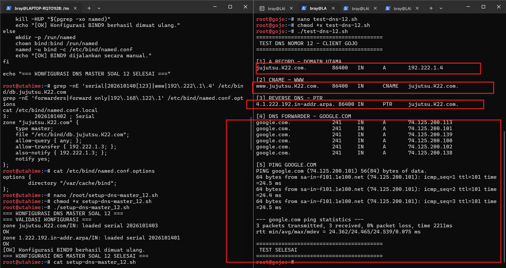

Script pengujiannya [test-dns-12.sh](nodes/switch1/gojo/test-dns-12.sh)

Berdasarkan konfigurasi tersebut, Utahime disiapkan untuk menangani pemetaan domain utama, alias domain, dan Reverse DNS, sekaligus meneruskan permintaan resolusi domain eksternal melalui DNS Forwarder. Pengujian dari Gojo digunakan untuk memeriksa kesesuaian pemetaan domain dan konektivitas eksternal setelah konfigurasi diterapkan.

---

> 13. Kepala Sekolah Yaga dan Inumaki mendirikan database terpusat yang redundan agar log aktivitas kutukan tetap aman tersimpan. Konfigurasikan MariaDB pada yaga sebagai DB-Master dan inumaki sebagai DB-Slave. Buat database db_shibuya_<xxxx> beserta tabel request_logs di Master, aktifkan binary logging (log-bin, server-id), lalu hubungkan inumaki sebagai Slave yang menyalin data secara realtime dengan CHANGE MASTER TO. Berikan hak akses remote bagi seluruh node di Network 4, lalu buktikan replikasi berhasil dengan memasukkan data baru di Master dan memeriksa hasilnya di Slave.

Disini, kami melakukan konfigurasi replikasi database menggunakan MariaDB dengan menerapkan arsitektur Master-Slave. Node Yaga bertindak sebagai DB-Master yang menyimpan database `db_shibuya_K22` beserta tabel `request_logs`, sedangkan node Inumaki bertindak sebagai DB-Slave yang menerima perubahan data dari Master secara otomatis. Konfigurasi ini menggunakan binary logging untuk mencatat perubahan pada database, sehingga data yang dimasukkan pada Master dapat direplikasi ke Slave.

**1. Konfigurasi Database Master (Yaga)**

Alur konfigurasi pada Yaga adalah sebagai berikut:

1. **Instalasi MariaDB**  
   Script `setup-mariadb-master-13.sh` memperbarui daftar paket dan menginstal `mariadb-server` serta `mariadb-client`. Kedua paket tersebut digunakan untuk menjalankan layanan database dan mengelola database melalui terminal.

2. **Konfigurasi Binary Logging**  
   Script membuat file konfigurasi `/etc/mysql/mariadb.conf.d/60-master.cnf` dengan parameter berikut:

   ```ini
   [mysqld]
   server-id=1
   bind-address=0.0.0.0
   log_bin=/var/log/mysql/mariadb-bin
   binlog_format=ROW
   gtid_strict_mode=ON
   log_slave_updates=ON
   ```

   Parameter `server-id=1` digunakan sebagai identitas unik server database Master. Sementara itu, `log_bin` mengaktifkan pencatatan perubahan database ke dalam binary log, dan `binlog_format=ROW` menentukan bahwa perubahan data dicatat berdasarkan baris yang terpengaruh. Parameter GTID juga diaktifkan untuk mendukung identifikasi transaksi pada mekanisme replikasi.

3. **Persiapan Direktori Binary Log**  
   Script membuat direktori `/var/log/mysql` dan menetapkan kepemilikannya kepada pengguna `mysql`. Direktori ini digunakan untuk menyimpan berkas binary log yang dihasilkan oleh MariaDB.

4. **Pembuatan Database dan Tabel**  
   Script membuat database `db_shibuya_K22` serta tabel `request_logs`. Tabel tersebut memiliki kolom `id`, `source_ip`, `request_path`, `method`, `status_code`, dan `created_at`. Struktur ini digunakan untuk menyimpan informasi aktivitas request yang nantinya dapat dikelola oleh layanan aplikasi.

5. **Pembuatan Akun Replikasi dan Akses Aplikasi**  
   Script membuat akun `replicator` yang diberikan hak `REPLICATION SLAVE` untuk koneksi dari subnet Network 4 (`192.222.4.%`). Selain itu, dibuat akun `shibuya_app` dengan hak akses terhadap database `db_shibuya_K22`. Akun tersebut disiapkan agar node aplikasi di Network 4 dapat mengakses database sesuai hak yang diberikan.

6. **Validasi Konfigurasi Master**  
   Setelah konfigurasi diterapkan, script memeriksa variabel `server_id`, status `log_bin`, serta menjalankan `SHOW MASTER STATUS`. Pemeriksaan ini digunakan untuk memastikan identitas server dan binary logging telah dikonfigurasi pada MariaDB.

Scriptnya [setup-mariadb-master-13.sh](nodes/switch1/yaga/setup-mariadb-master-13.sh)

**2. Konfigurasi Database Slave (Inumaki)**

Node Inumaki dikonfigurasi sebagai server sekunder yang menerima replikasi dari Yaga. Konfigurasi ini bertujuan agar perubahan data pada Master dapat diterapkan pada database Slave tanpa harus memasukkan data yang sama secara manual.

Alur konfigurasi pada Inumaki adalah sebagai berikut:

1. **Instalasi MariaDB**  
   MariaDB dipasang pada Inumaki agar node tersebut dapat menjalankan layanan database dan menerima perubahan data dari Master.

2. **Konfigurasi Identitas Server Slave**  
   MariaDB pada Inumaki dikonfigurasi menggunakan `server-id` yang berbeda dari Master. Perbedaan identitas tersebut diperlukan agar kedua server dapat dibedakan dalam topologi replikasi.

3. **Konfigurasi Koneksi Replikasi**  
   Inumaki dihubungkan ke Yaga menggunakan perintah `CHANGE MASTER TO` dengan informasi alamat Master, akun replikasi, serta posisi binary log atau informasi GTID yang sesuai dengan konfigurasi yang digunakan. Setelah itu, proses replikasi dijalankan agar Slave mulai mengambil dan menerapkan perubahan dari Master.

4. **Pemeriksaan Status Replikasi**  
   Status replikasi diperiksa menggunakan `SHOW SLAVE STATUS`. Informasi seperti status thread I/O dan SQL, alamat Master, serta pesan kesalahan digunakan untuk memastikan proses penerimaan dan penerapan perubahan data berjalan sesuai konfigurasi.

**3. Pengujian Replikasi Database Master–Slave**

Setelah konfigurasi kedua server diterapkan, pengujian dilakukan untuk memeriksa apakah data yang dimasukkan ke dalam database Master dapat muncul pada database Slave.

Pengujian dilakukan dengan memasukkan data baru ke tabel `request_logs` pada Yaga. Selanjutnya, tabel yang sama diperiksa pada Inumaki untuk memastikan bahwa perubahan tersebut telah direplikasi.

Pemeriksaan dapat dilakukan dengan query berikut pada kedua node:

```sql
USE db_shibuya_K22;

SELECT * FROM request_logs;
```

Selain itu, status replikasi pada Inumaki dapat diperiksa menggunakan:

```sql
SHOW SLAVE STATUS\G
```

Hasil pengujian dinyatakan berhasil apabila data yang dimasukkan pada Yaga muncul pada Inumaki dan proses replikasi tidak menunjukkan kesalahan. Dengan demikian, konfigurasi ini menyediakan salinan data pada server sekunder yang dapat membantu menjaga ketersediaan data apabila terjadi gangguan pada server utama.

Hasilnya:

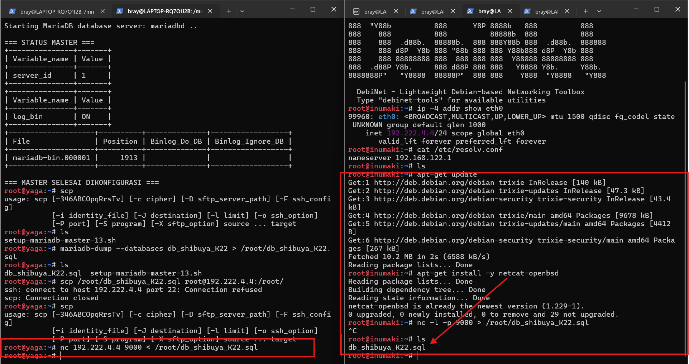

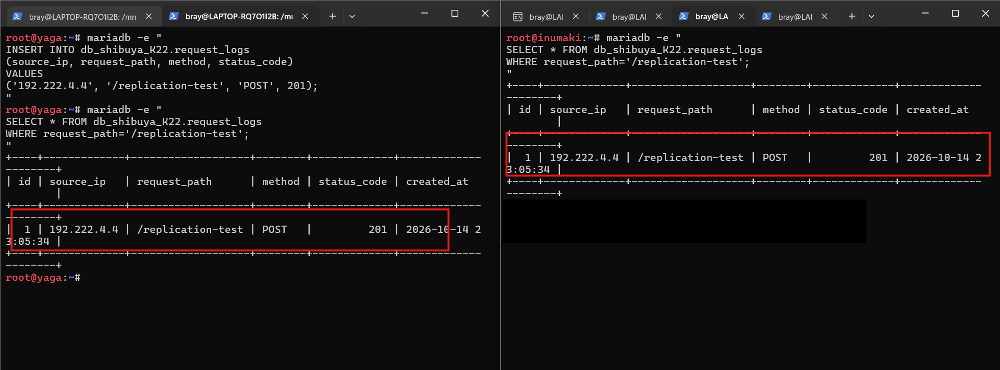

---

> 14. Para penyihir lapangan bersiaga di Data Center sebagai pekerja backend untuk memproses aplikasi. Pasang Nginx dan PHP-FPM pada maki dan panda untuk menyajikan web frontend yang menampilkan hostname masing-masing. Pada nanami, todo, dan kirara, siapkan layanan API yang mencatat log request ke database yaga. Konfigurasikan virtual host agar worker merespons domain layanan yang ditentukan. Batasi akses langsung dari klien ke worker, web worker hanya menerima trafik melalui jalur proxy web yang ditentukan, sedangkan worker API hanya menerima trafik melalui geto. Uji bahwa akses langsung dari klien ditolak, sementara akses melalui reverse proxy tetap berhasil.

Disini, kami melakukan konfigurasi worker frontend dan API pada jaringan Data Center. Node Maki dan Panda digunakan untuk melayani halaman web yang menampilkan hostname masing-masing, sedangkan Nanami, Todo, dan Kirara digunakan untuk menyediakan layanan API yang terhubung dengan database Yaga. Selain menyiapkan layanan pada masing-masing worker, konfigurasi juga mencakup pengaturan virtual host dan pembatasan akses langsung dari klien agar permintaan hanya dapat diterima melalui jalur proxy yang telah ditentukan.

**1. Konfigurasi Worker Frontend (Maki dan Panda)**

Alur konfigurasi pada worker frontend adalah sebagai berikut:

1. **Instalasi Nginx dan PHP-FPM**  
   Nginx dan PHP-FPM dipasang pada Maki dan Panda untuk menyediakan layanan web frontend. Nginx bertugas menerima permintaan HTTP, sedangkan PHP-FPM digunakan untuk memproses halaman PHP yang dijalankan oleh web server.

2. **Konfigurasi Halaman Frontend**  
   Masing-masing worker dikonfigurasi agar halaman web menampilkan hostname server yang sedang melayani permintaan. Dengan demikian, identitas worker dapat diketahui melalui respons yang diberikan ketika halaman diakses.

3. **Konfigurasi Virtual Host**  
   Virtual host disiapkan agar worker merespons permintaan yang ditujukan ke domain layanan frontend. Konfigurasi ini memungkinkan Nginx mengenali permintaan berdasarkan nama host yang diterima.

4. **Pembatasan Akses Langsung**  
   Akses langsung dari klien ke worker frontend dibatasi agar permintaan web melewati jalur reverse proxy yang telah ditentukan. Pembatasan ini bertujuan agar worker tidak menjadi titik akses publik yang dapat dihubungi secara langsung oleh klien.

Untuk script di kedua node tersebut sama, yaitu:

[setup-web-worker-14.sh](nodes/switch6/switch7/maki/setup-web-worker-14.sh)

[secure-web-worker-14.sh](nodes/switch6/switch7/maki/secure-web-worker-14.sh)

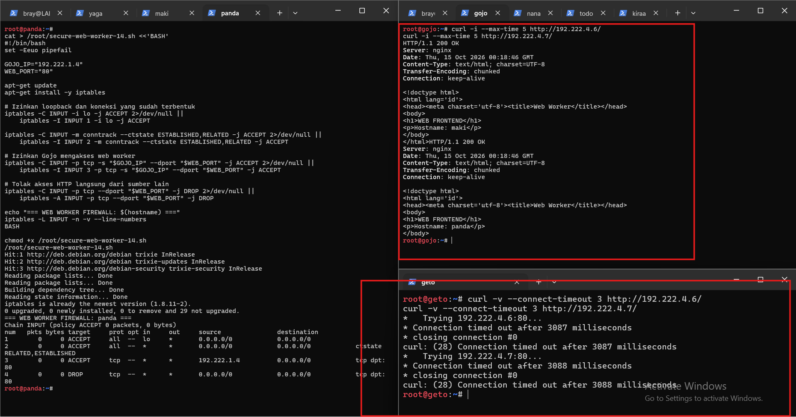

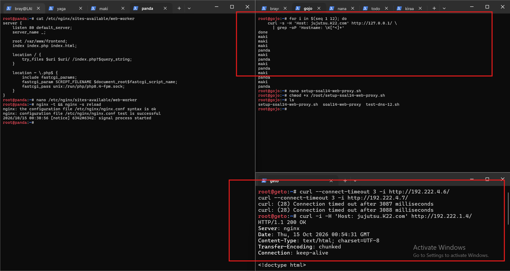

**2. Konfigurasi Worker API (Nanami, Todo, dan Kirara)**

Worker API disiapkan untuk menangani permintaan aplikasi dan mencatat aktivitas request ke database Yaga. Alur konfigurasinya adalah sebagai berikut:

1. **Persiapan Layanan API**  
   Nanami, Todo, dan Kirara dikonfigurasi untuk menjalankan layanan API yang dapat menerima permintaan HTTP melalui domain layanan yang ditentukan.

2. **Konfigurasi Virtual Host**  
   Virtual host disiapkan pada worker API agar permintaan dengan nama host layanan yang sesuai dapat diproses oleh aplikasi. Pengaturan ini membantu memisahkan layanan API dari layanan frontend.

3. **Integrasi dengan Database Yaga**  
   Layanan API dihubungkan dengan database Yaga untuk mencatat informasi request ke dalam tabel `request_logs`. Pencatatan ini digunakan untuk menyimpan aktivitas permintaan yang diterima oleh layanan API.

4. **Pembatasan Akses Worker API**  
   Akses langsung dari klien ke worker API dibatasi. Permintaan API harus melewati Geto sebagai jalur proxy internal yang telah ditentukan. Dengan demikian, Geto menjadi perantara utama antara jalur akses aplikasi dan worker API.

Untuk script di ketiga node tersebut sama, yaitu:

[setup-api-worker-14.sh](nodes/switch6/switch7/todo/setup-api-worker-14.sh)

[secure-api-worker-14.sh](nodes/switch6/switch7/todo/secure-api-worker-14.sh)

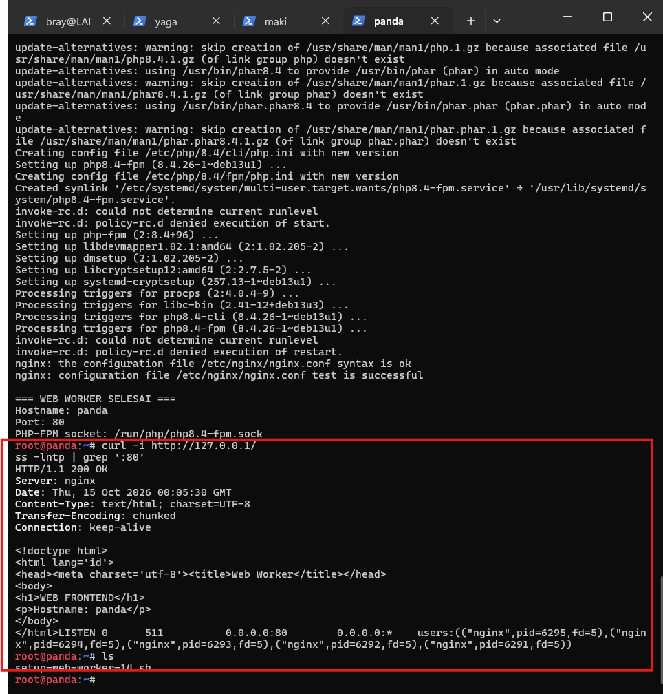

**Cek Log**
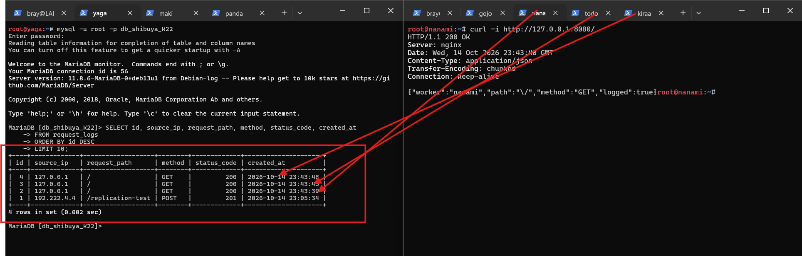

---

> 15. Geto bertugas mengendalikan pembagian beban request API di internal Data Center agar server tidak tumbang bersamaan. Konfigurasikan Nginx pada geto sebagai Load Balancer internal dengan upstream api_cluster yang mengarahkan trafik ke nanami dan todo. Terapkan algoritma Weighted Round Robin dengan bobot 3:1, di mana nanami menerima porsi beban tiga kali lebih banyak daripada todo. Buktikan distribusi beban ini dengan melakukan loop request berulang kali ke geto dari jaringan lokal Data Center dan periksa rasio responnya.

Disini, kami melakukan konfigurasi Nginx pada node Geto sebagai *Load Balancer* internal untuk membagi request API ke dua worker, yaitu Nanami dan Todo. Konfigurasi menggunakan algoritma *Weighted Round Robin* melalui upstream `api_cluster` dengan bobot 3:1. Dengan demikian, Nanami mendapatkan prioritas penanganan request tiga kali lebih besar daripada Todo. Pengujian dilakukan dengan mengirimkan 100 request secara berulang melalui Geto, kemudian menghitung jumlah respons yang dilayani masing-masing worker untuk memverifikasi distribusi beban.

**1. Konfigurasi Load Balancer pada Geto**

Alur konfigurasi pada Geto adalah sebagai berikut:

1. **Persiapan Nginx**

   Script `setup-soal15-geto.sh` memeriksa ketersediaan Nginx dan menginstalnya apabila belum tersedia. Script juga menyiapkan konfigurasi Load Balancer khusus Soal 15 serta mencadangkan konfigurasi Geto sebelumnya apabila berkas tersebut tersedia.

2. **Konfigurasi Upstream API Cluster**

   Script mendefinisikan upstream bernama `api_cluster` yang mengarahkan trafik ke Nanami dengan alamat IP `192.222.4.8` dan Todo dengan alamat IP `192.222.4.9`. Kedua worker menggunakan port `8080` sebagai tujuan penerusan request.

   Konfigurasi upstream yang digunakan adalah:

   ```nginx
   upstream api_cluster {
       server 192.222.4.8:8080 weight=3;
       server 192.222.4.9:8080 weight=1;
   }
   ```

   Parameter `weight=3` pada Nanami dan `weight=1` pada Todo menerapkan algoritma *Weighted Round Robin*. Pembagian ini membuat Nanami menerima porsi request tiga kali lebih besar daripada Todo berdasarkan bobot yang ditentukan.

3. **Konfigurasi Reverse Proxy**

   Pada virtual host `api.jujutsu.K22.com`, Geto dikonfigurasi untuk menerima request HTTP pada port 80. Selanjutnya, request yang masuk melalui lokasi `/` diteruskan ke upstream `api_cluster` menggunakan parameter `proxy_pass`.

   Selain itu, header `Host`, `X-Real-IP`, `X-Forwarded-For`, dan `X-Forwarded-Proto` diteruskan ke backend agar informasi host, alamat sumber request, dan protokol tetap tersedia ketika request diproses oleh worker API.

4. **Aktivasi dan Validasi Konfigurasi**

   Script mengaktifkan konfigurasi melalui symbolic link pada direktori `/etc/nginx/sites-enabled/`. Sebelum diterapkan, konfigurasi diperiksa menggunakan `nginx -t`. Jika validasi berhasil, Nginx dimuat ulang apabila sudah berjalan atau dijalankan apabila belum aktif.

Script yang digunakan adalah [setup-soal15-geto.sh](nodes/switch6/switch7/geto/setup-soal15-geto.sh).

**2. Pengujian Distribusi Request API**

Setelah konfigurasi Load Balancer diterapkan, pengujian dilakukan pada node Geto dengan mengirimkan 100 request secara berulang ke `http://127.0.0.1/`. Setiap request menyertakan header `Host: api.jujutsu.K22.com` agar request diproses melalui virtual host yang sesuai.

Respons API diperiksa untuk mengambil nilai field `worker`. Jika respons menunjukkan `nanami`, penghitung request Nanami ditambah satu. Jika menunjukkan `todo`, penghitung request Todo ditambah satu. Respons yang tidak cocok dengan kedua nama worker dihitung sebagai request gagal.

Perintah pengujian yang digunakan adalah:

```bash
nanami=0
todo=0
gagal=0

for i in $(seq 1 100); do
    worker=$(curl -s --connect-timeout 3 \
        -H 'Host: api.jujutsu.K22.com' \
        http://127.0.0.1/ | \
        grep -oP '"worker"\s*:\s*"\K[^"]+')

    case "$worker" in
        nanami) ((nanami+=1)) ;;
        todo)   ((todo+=1)) ;;
        *)      ((gagal+=1)) ;;
    esac
done

echo "Nanami: $nanami"
echo "Todo  : $todo"
echo "Gagal : $gagal"
```

Hasil tersebut menunjukkan bahwa Nanami menangani 75 request, sedangkan Todo menangani 25 request. Perbandingan keduanya adalah 75:25 atau 3:1, sesuai dengan bobot yang ditetapkan pada konfigurasi upstream `api_cluster`. Tidak terdapat request gagal pada pengujian kedua.

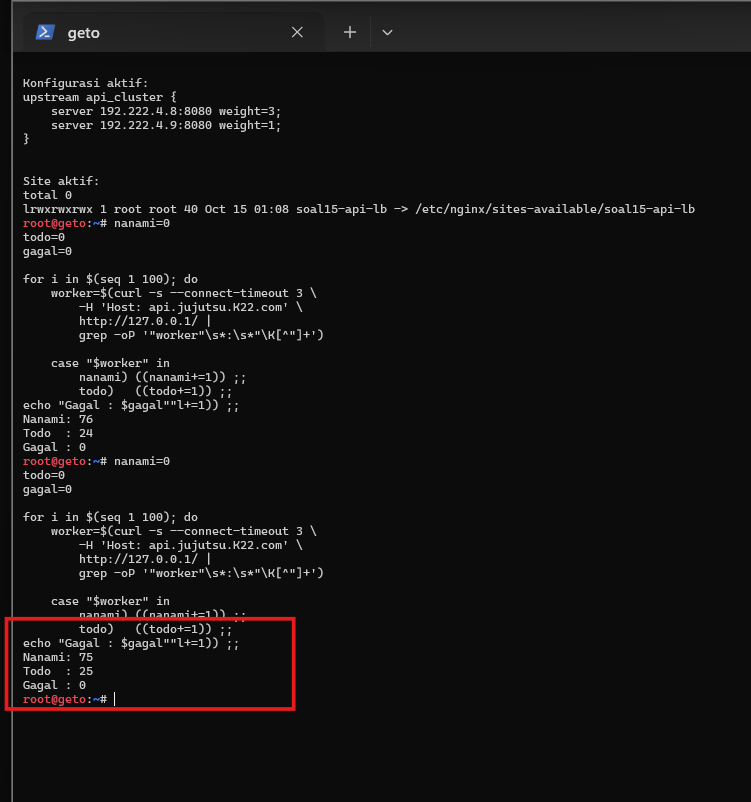

---

> 16. Gojo berdiri di perbatasan DMZ sebagai gerbang publik tunggal bagi seluruh client dari luar maupun dalam. Konfigurasikan Nginx pada gojo untuk melayani domain jujutsu.\<xxxx>.com dan www.jujutsu.\<xxxx>.com menggunakan metode Path-Based Routing. Atur agar request root (/) diteruskan secara Round Robin ke worker frontend (maki dan panda), sedangkan request ke path /api diteruskan langsung ke geto. Uji dari client Divisi A atau B bahwa akses ke web utama dibalas oleh Maki/Panda, sedangkan akses ke /api diteruskan dan dijawab oleh Nanami/Todo.

Disini, kami melakukan konfigurasi Nginx pada node Gojo sebagai *public gateway* yang menjadi pintu masuk untuk mengakses layanan web dan API. Konfigurasi menggunakan metode *Path-Based Routing*, yaitu membedakan tujuan request berdasarkan path yang diakses. Request menuju path `/` diteruskan menggunakan algoritma *Round Robin* ke worker frontend Maki dan Panda, sedangkan request menuju `/api` diteruskan ke Geto untuk selanjutnya diproses oleh worker API Nanami dan Todo. Pengujian dilakukan dari node Fushiguro untuk memeriksa konektivitas Gojo, resolusi domain, distribusi request frontend, serta penerusan request API.

**1. Konfigurasi Public Gateway pada Gojo**

Alur konfigurasi pada Gojo adalah sebagai berikut:

1. **Instalasi Nginx**

   Script `setup-soal16-gojo.sh` memeriksa ketersediaan Nginx dan melakukan instalasi apabila layanan tersebut belum tersedia. Script juga mencadangkan konfigurasi Soal 14 apabila berkas sebelumnya tersedia, sehingga konfigurasi gateway dapat diperbarui untuk memenuhi kebutuhan Soal 16.

2. **Konfigurasi Upstream Frontend**

   Script mendefinisikan upstream `frontend_workers` yang mengarahkan request ke Maki dengan alamat IP `192.222.4.6` dan Panda dengan alamat IP `192.222.4.7`. Kedua worker menggunakan port 80.

   Konfigurasi upstream yang digunakan adalah:

   ```nginx
   upstream frontend_workers {
       server 192.222.4.6:80;
       server 192.222.4.7:80;
   }
   ```

   Kedua server tersebut tidak diberikan bobot khusus, sehingga Nginx menggunakan algoritma *Round Robin* secara default untuk membagi request secara bergantian ke Maki dan Panda.

3. **Konfigurasi Upstream API**

   Selain frontend, script mendefinisikan upstream `api_gateway` yang mengarahkan request API ke Geto dengan alamat IP `192.222.4.5` pada port 80.

   ```nginx
   upstream api_gateway {
       server 192.222.4.5:80;
   }
   ```

   Geto bertugas sebagai perantara untuk meneruskan request menuju worker API, yaitu Nanami dan Todo, sesuai konfigurasi Load Balancer pada Soal 15.

4. **Konfigurasi Path-Based Routing**

   Virtual host dikonfigurasi untuk melayani domain `jujutsu.K22.com` dan `www.jujutsu.K22.com`. Pada lokasi `/api` dan `/api/`, request diteruskan ke upstream `api_gateway`. Sementara itu, request pada lokasi `/` diteruskan ke upstream `frontend_workers`.

   Konfigurasi ini memastikan bahwa request web utama diproses oleh Maki atau Panda, sedangkan request API melewati Geto sebelum mencapai worker API.

5. **Penerusan Header dan Aktivasi Konfigurasi**

   Gojo meneruskan header `Host`, `X-Real-IP`, `X-Forwarded-For`, dan `X-Forwarded-Proto` sesuai kebutuhan masing-masing jalur proxy. Script kemudian mengaktifkan konfigurasi pada `/etc/nginx/sites-enabled/soal16-public-gateway`, menonaktifkan konfigurasi lama yang berpotensi berbenturan, memvalidasi konfigurasi menggunakan `nginx -t`, dan menjalankan atau memuat ulang Nginx.

Script yang digunakan adalah [setup-soal16-gojo.sh](nodes/switch1/gojo/setup-soal16-gojo.sh).

**2. Pengujian Path-Based Routing dari Fushiguro**

Setelah konfigurasi pada Gojo diterapkan, pengujian dilakukan dari node Fushiguro menggunakan script `test-soal16.sh`. Pengujian ini mencakup konektivitas ke Gojo, resolusi domain, distribusi request web, penerusan request API, dan akses melalui alias domain `www`.

1. **Pengujian Konektivitas Gojo**

   Pengujian dilakukan menggunakan perintah `ping` ke alamat IP `192.222.1.4`. Hasil pengujian menunjukkan bahwa tiga paket ICMP berhasil diterima tanpa packet loss. Hal ini menunjukkan bahwa Fushiguro dapat berkomunikasi dengan Gojo melalui jaringan.

2. **Pengujian Resolusi Domain**

   Perintah `nslookup` digunakan untuk memeriksa domain `jujutsu.K22.com` dan `www.jujutsu.K22.com` melalui DNS Utahime dengan alamat IP `192.222.1.2`. Hasilnya menunjukkan bahwa domain utama mengarah ke alamat IP Gojo, yaitu `192.222.1.4`, sedangkan domain `www` menjadi alias dari domain utama.

3. **Pengujian Round Robin pada Frontend**

   Script mengirimkan 12 request ke `http://jujutsu.K22.com/` dan membaca hostname worker dari setiap respons. Hasil pengujian menunjukkan bahwa Maki menangani 6 request dan Panda menangani 6 request, tanpa request gagal.

   Hasil tersebut menunjukkan bahwa request web utama berhasil didistribusikan secara merata ke kedua worker frontend menggunakan algoritma *Round Robin*.

4. **Pengujian Routing API**

   Script mengirimkan 12 request ke `http://jujutsu.K22.com/api`. Setiap respons diperiksa berdasarkan field `worker` untuk mengidentifikasi apakah request dilayani oleh Nanami atau Todo. Pada screenshot pengujian, respons API yang terlihat menunjukkan bahwa request telah diteruskan dan dijawab oleh kedua worker tersebut.

   Dengan demikian, hasil yang terlihat pada terminal membuktikan bahwa jalur `/api` tidak diarahkan ke worker frontend, melainkan diteruskan melalui Geto menuju layanan API. Namun, karena screenshot yang tersedia terpotong sebelum seluruh 12 request dan rekap akhirnya terlihat, jumlah akhir request untuk Nanami, Todo, dan request gagal belum dapat dipastikan dari bukti tersebut.

5. **Pengujian Alias Domain WWW**

   Script juga mengirimkan request ke `http://www.jujutsu.K22.com/` dan `http://www.jujutsu.K22.com/api`, kemudian memeriksa kode status HTTP yang diterima. Tahap ini digunakan untuk memeriksa apakah kedua jalur layanan dapat diakses melalui alias domain `www`.

Script pengujian yang digunakan adalah [test-soal16.sh](nodes/switch2/switch3/fushiguro/test-soal16.sh).

**Hasilnya:**

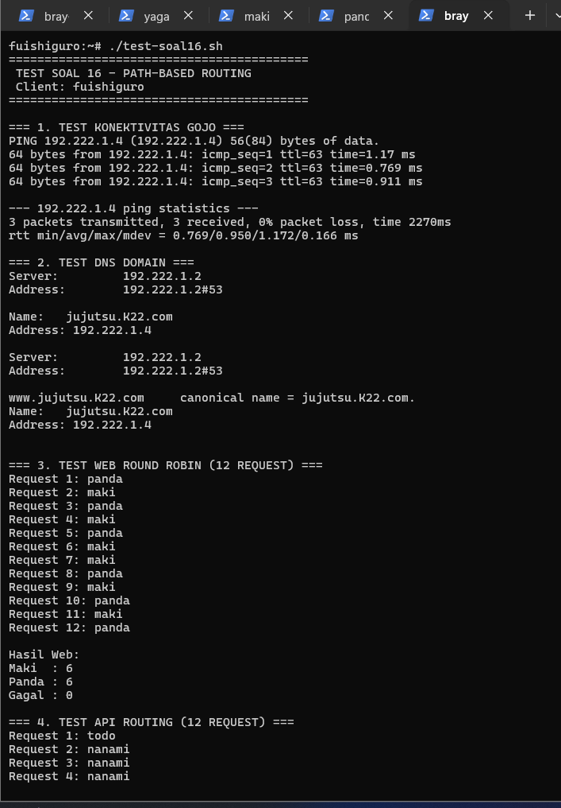

---

> 17. Komando pusat perlu mengetahui IP asli klien yang mengirimkan request tanpa tertukar dengan IP proxy perantara. Konfigurasikan gojo dan geto agar meneruskan informasi alamat klien melalui header X-Real-IP dan X-Forwarded-For. Pastikan geto hanya mempercayai informasi alamat klien yang diterima dari proxy terpercaya, dan skrip API menyimpan alamat klien yang telah diverifikasi ke kolom client_ip pada tabel request_logs di database yaga. Uji dengan mengirimkan request dari klien Network 2 dan Network 3 ke endpoint /api, kemudian periksa database untuk memastikan alamat yang tercatat sesuai dengan IP klien asal, bukan IP gojo atau geto.

Disini, kami melakukan konfigurasi penerusan alamat IP klien pada node Gojo dan Geto agar layanan API dapat mengetahui alamat sumber request yang sebenarnya. Gojo dikonfigurasi untuk meneruskan informasi alamat klien melalui header `X-Real-IP` dan `X-Forwarded-For`, sedangkan Geto hanya mempercayai informasi IP yang berasal dari proxy terpercaya, yaitu Gojo. Selanjutnya, layanan API pada Nanami dan Todo diperbarui agar menyimpan alamat IP klien yang telah diverifikasi ke kolom `client_ip` pada tabel `request_logs` di database Yaga. Pengujian dilakukan dari node Fushiguro, kemudian hasil pencatatan diperiksa langsung pada database Yaga.

**1. Konfigurasi Penerusan IP Klien pada Gojo**

Alur konfigurasi pada Gojo adalah sebagai berikut:

1. **Pencadangan Konfigurasi Nginx**

   Script `setup-soal17-gojo.sh` mencadangkan konfigurasi gateway sebelumnya dari file `/etc/nginx/sites-available/soal16-public-gateway`. Pencadangan ini dilakukan agar konfigurasi sebelum penerapan Soal 17 tetap tersedia apabila diperlukan untuk pemulihan.

2. **Penyesuaian Header X-Forwarded-For**

   Script memperbarui konfigurasi Nginx dengan mengganti nilai header `X-Forwarded-For` menjadi `$remote_addr`. Dengan pengaturan ini, Gojo menggunakan alamat IP sumber koneksi yang diterimanya untuk mengisi header tersebut, alih-alih meneruskan nilai header dari klien tanpa perubahan.

3. **Penerusan Informasi IP ke Backend**

   Header `X-Real-IP` tetap menggunakan `$remote_addr`, sedangkan `X-Forwarded-For` diatur menggunakan alamat sumber koneksi. Kedua header tersebut digunakan untuk menyampaikan informasi alamat IP klien kepada layanan di belakang Gojo.

4. **Validasi dan Penerapan Konfigurasi**

   Setelah perubahan diterapkan, script menjalankan `nginx -t` untuk memvalidasi sintaks konfigurasi. Jika validasi berhasil, Nginx dimuat ulang menggunakan `nginx -s reload` agar perubahan dapat digunakan oleh layanan yang sedang berjalan.

Script yang digunakan adalah [setup-soal17-gojo.sh](nodes/switch1/gojo/setup-soal17-gojo.sh).

**2. Konfigurasi Trusted Proxy pada Geto**

Geto bertugas menerima request yang diteruskan Gojo, memverifikasi informasi IP klien berdasarkan proxy terpercaya, kemudian meneruskan informasi tersebut kepada worker API.

Alur konfigurasi pada Geto adalah sebagai berikut:

1. **Pencadangan Konfigurasi Load Balancer**

   Script `setup-soal17-geto.sh` mencadangkan konfigurasi `/etc/nginx/sites-available/soal15-api-lb` sebelum melakukan perubahan. Dengan demikian, konfigurasi Load Balancer yang digunakan pada Soal 15 tetap memiliki salinan cadangan.

2. **Penetapan Proxy Terpercaya**

   Script menambahkan konfigurasi berikut pada virtual host API:

   ```nginx
   set_real_ip_from 192.222.1.4;
   real_ip_header X-Real-IP;
   real_ip_recursive on;
   ```

   Parameter `set_real_ip_from 192.222.1.4` menetapkan Gojo sebagai proxy terpercaya berdasarkan alamat IP-nya. Sementara itu, `real_ip_header X-Real-IP` menentukan header yang digunakan Nginx untuk memperoleh alamat IP klien, dan `real_ip_recursive on` mengaktifkan pemrosesan alamat IP secara rekursif sesuai konfigurasi modul Real IP.

3. **Penerusan IP Terverifikasi ke Worker API**

   Setelah alamat IP klien diproses oleh Geto, header `X-Real-IP` dan `X-Forwarded-For` diteruskan kepada worker API menggunakan nilai `$remote_addr`. Tujuannya agar worker menerima alamat IP yang telah diproses oleh Geto, bukan langsung mempercayai header yang dikirimkan oleh klien.

4. **Validasi Konfigurasi Nginx**

   Script menjalankan `nginx -t` untuk memeriksa konfigurasi, kemudian memuat ulang Nginx menggunakan `nginx -s reload`. Setelah itu, konfigurasi diperiksa kembali menggunakan `nginx -T` untuk memastikan parameter trusted proxy dan header penerusan IP telah diterapkan.

Script yang digunakan adalah [setup-soal17-geto.sh](nodes/switch6/switch7/geto/setup-soal17-geto.sh).

**3. Penyesuaian Database Yaga**

Database Yaga digunakan untuk menyimpan log request API, termasuk alamat IP klien yang telah diverifikasi. Oleh karena itu, tabel `request_logs` perlu memiliki kolom tambahan `client_ip`.

Alur konfigurasi pada Yaga adalah sebagai berikut:

1. **Penambahan Kolom client_ip**

   Script `setup-soal17-yaga.sh` menjalankan perintah SQL untuk menambahkan kolom `client_ip` dengan tipe data `VARCHAR(45)` pada tabel `request_logs`. Tipe data tersebut dapat menampung alamat IPv4 maupun IPv6.

   Perintah SQL yang digunakan adalah:

   ```sql
   ALTER TABLE request_logs
       ADD COLUMN IF NOT EXISTS client_ip VARCHAR(45) NULL
       AFTER source_ip;
   ```

   Kolom `client_ip` diletakkan setelah `source_ip` agar informasi sumber request dan alamat klien yang telah diverifikasi dapat disimpan secara terpisah.

2. **Validasi Struktur Tabel**

   Setelah script dijalankan, kolom `client_ip` tersedia pada tabel `request_logs`. Kolom tersebut kemudian digunakan oleh layanan API untuk menyimpan alamat IP klien yang diterima melalui header terpercaya dari jalur proxy.

Script yang digunakan adalah [setup-soal17-yaga.sh](nodes/switch6/switch10/yaga/setup-soal17-yaga.sh).

**4. Penyesuaian Layanan API pada Nanami dan Todo**

Worker API pada Nanami dan Todo diperbarui agar dapat menyimpan alamat IP klien yang telah diverifikasi ke database Yaga.

Alur konfigurasi pada kedua worker adalah sebagai berikut:

1. **Pemeriksaan File Layanan API**

   Script `setup-soal17-api.sh` memeriksa keberadaan file `/var/www/api/index.php` dan memastikan bahwa kode sebelumnya memiliki query `INSERT INTO request_logs`. Script juga membuat salinan cadangan sebelum melakukan perubahan.

2. **Validasi Alamat IP Klien**

   Kode API diperbarui agar membaca alamat IP dari header `HTTP_X_REAL_IP`. Jika alamat tersebut tidak tersedia atau tidak valid menurut `FILTER_VALIDATE_IP`, layanan akan mengembalikan HTTP 400 dan menghentikan pemrosesan request. Dengan demikian, layanan tidak langsung menggunakan `REMOTE_ADDR` sebagai pengganti ketika alamat IP terverifikasi tidak tersedia.

3. **Penyimpanan IP ke Database**

   Query `INSERT INTO request_logs` diperbarui untuk menyimpan nilai IP ke kolom `source_ip` dan `client_ip`, bersamaan dengan informasi path request, metode HTTP, serta status respons. Perubahan parameter `bind_param` disesuaikan dengan jumlah kolom yang dimasukkan.

4. **Validasi Kode PHP**

   Setelah perubahan dilakukan, script menjalankan `php -l` untuk memeriksa sintaks PHP dan menampilkan bagian kode yang telah diperbarui. Tahapan ini membantu memastikan bahwa perubahan pada pemilihan IP dan query database tidak menghasilkan kesalahan sintaks.

Script yang digunakan pada kedua worker adalah [setup-soal17-api.sh](nodes/switch6/switch7/nanami/setup-soal17-api.sh). Script yang sama juga tersedia pada direktori Todo, yaitu [setup-soal17-api.sh](nodes/switch6/switch7/todo/setup-soal17-api.sh).

**5. Pengujian dari Klien Fushiguro**

Setelah konfigurasi pada Gojo, Geto, Yaga, Nanami, dan Todo diterapkan, pengujian dilakukan dari node Fushiguro. Script `test-soal17-client.sh` digunakan untuk memeriksa resolusi domain, akses API, dan konsistensi respons melalui endpoint `/api`.

Alur pengujian adalah sebagai berikut:

1. **Pengujian Resolusi Domain**

   Script menggunakan `getent hosts` untuk memeriksa apakah domain `jujutsu.K22.com` dapat di-resolve. Pengujian ini memastikan klien dapat menemukan alamat tujuan berdasarkan konfigurasi DNS yang tersedia.

2. **Pengujian Akses Endpoint API**

   Script mengirimkan request ke `http://jujutsu.K22.com/api` menggunakan `curl`. Respons disimpan pada `/tmp/test-soal17-response.json`, kemudian kode status HTTP diperiksa. Respons HTTP 200 dihitung sebagai pengujian berhasil.

3. **Pengujian Konsistensi Request**

   Script mengirimkan lima request tambahan ke endpoint API dan memeriksa kode status HTTP masing-masing. Tahapan ini digunakan untuk memastikan layanan tetap dapat diakses secara berulang melalui jalur proxy.

4. **Pemeriksaan Database Yaga**

   Setelah pengujian dari klien dilakukan, tabel `request_logs` diperiksa langsung pada Yaga untuk memastikan alamat IP klien tersimpan pada kolom `client_ip`.

   Perintah yang digunakan pada Yaga adalah:

   ```sql
   USE db_shibuya_K22;

   SELECT id, source_ip, client_ip, request_path, created_at
   FROM request_logs
   ORDER BY id DESC
   LIMIT 10;
   ```

Script pengujian yang digunakan adalah [test-soal17-client.sh](nodes/switch2/switch3/fushiguro/test-soal17-client.sh).

**Hasilnya:**

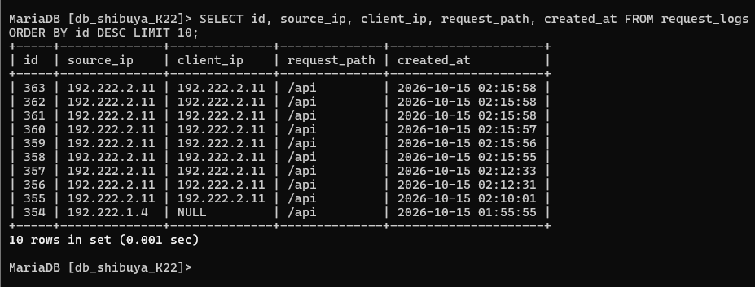

Berdasarkan hasil query pada database Yaga, beberapa request terbaru memiliki nilai `source_ip` dan `client_ip` yang sama, yaitu `192.222.2.11`, dengan path request `/api`. Hal ini menunjukkan bahwa alamat IP klien tersebut tercatat pada kedua kolom. Pada salah satu entri yang lebih lama, `source_ip` tercatat sebagai `192.222.1.4`, sedangkan `client_ip` masih bernilai `NULL`. Entri tersebut memperlihatkan perbedaan data sebelum kolom `client_ip` terisi pada request yang lebih baru.

---

> 18. Nanami dan Todo merupakan worker API utama, sedangkan Kirara disiapkan sebagai worker cadangan. Konfigurasikan upstream api_cluster pada geto agar kirara menjadi server backup, serta terapkan passive health check dengan parameter max_fails=2 dan fail_timeout=5s pada worker API utama. Pastikan kirara menjalankan layanan API yang kompatibel dengan endpoint utama. Simulasikan gangguan dengan menghentikan layanan Nginx atau layanan API pada nanami dan todo. Buktikan dari klien bahwa request ke /api dialihkan ke kirara dan menghasilkan respons API yang valid tanpa error 502 Bad Gateway.

Disini, kami melakukan konfigurasi Nginx pada node Geto untuk menambahkan Kirara sebagai *backup worker* bagi layanan API yang sebelumnya menggunakan Nanami dan Todo sebagai worker utama. Konfigurasi menggunakan mekanisme *passive health check* dengan parameter `max_fails=2` dan `fail_timeout=5s` pada kedua worker utama. Dengan mekanisme ini, Nginx menandai worker sebagai tidak tersedia sementara apabila memenuhi batas kegagalan koneksi yang telah ditentukan. Pengujian dilakukan dengan menghentikan layanan Nginx pada Nanami dan Todo, kemudian mengirimkan request ke endpoint `/api` dari Fushiguro untuk memastikan request dialihkan ke Kirara tanpa menghasilkan HTTP 502 Bad Gateway.

**1. Konfigurasi Backup Worker pada Geto**

Alur konfigurasi pada Geto adalah sebagai berikut:

1. **Pencadangan Konfigurasi Load Balancer**

   Script `setup-soal18-geto.sh` memeriksa keberadaan file konfigurasi `/etc/nginx/sites-available/soal15-api-lb`. Apabila file tersebut tersedia, script membuat salinan cadangan dengan menambahkan penanda waktu pada nama file. Langkah ini dilakukan agar konfigurasi Load Balancer sebelumnya tetap dapat dipulihkan apabila diperlukan.

2. **Penambahan Kirara sebagai Backup Worker**

   Script memperbarui blok upstream `api_cluster` agar mencakup Nanami, Todo, dan Kirara. Nanami dan Todo tetap menjadi worker utama, sedangkan Kirara ditetapkan sebagai server cadangan menggunakan parameter `backup`.

   Konfigurasi upstream yang digunakan adalah:

   ```nginx
   upstream api_cluster {
       server 192.222.4.8:8080 weight=3 max_fails=2 fail_timeout=5s;
       server 192.222.4.9:8080 weight=1 max_fails=2 fail_timeout=5s;
       server 192.222.4.10:8080 backup;
   }
   ```

   Nanami menggunakan alamat IP `192.222.4.8` dan Todo menggunakan alamat IP `192.222.4.9`, keduanya melalui port `8080`. Parameter `max_fails=2` menentukan batas kegagalan yang digunakan untuk menandai worker utama sebagai tidak tersedia, sedangkan `fail_timeout=5s` menentukan periode waktu terkait pencatatan kegagalan dan penonaktifan sementara worker. Sementara itu, parameter `backup` pada Kirara membuat worker tersebut menerima request ketika worker utama tidak tersedia.

3. **Validasi Konfigurasi Nginx**

   Setelah blok upstream diperbarui, script menjalankan `nginx -t` untuk memeriksa sintaks konfigurasi. Apabila validasi berhasil, Nginx dimuat ulang menggunakan `nginx -s reload` agar konfigurasi terbaru diterapkan.

4. **Pemeriksaan Upstream Aktif**

   Script menampilkan konfigurasi upstream yang sedang digunakan melalui perintah `nginx -T`, kemudian mengambil bagian `api_cluster`. Pemeriksaan ini digunakan untuk memastikan bahwa Nanami, Todo, serta Kirara telah tercantum dengan parameter yang sesuai.

Script yang digunakan adalah [setup-soal18-geto.sh](nodes/switch6/switch7/geto/setup-soal18-geto.sh).

**2. Persiapan Worker Cadangan Kirara**

Kirara disiapkan untuk menjalankan layanan API yang kompatibel dengan endpoint utama agar dapat menerima request ketika Nanami dan Todo mengalami gangguan. Layanan API pada Kirara menggunakan port `8080` dan domain layanan `api.jujutsu.K22.com`.

Pemeriksaan layanan pada Kirara dilakukan menggunakan perintah berikut:

```bash
hostname
ip -br addr
ss -lntp | grep ':8080'
curl -i -H 'Host: api.jujutsu.K22.com' http://127.0.0.1:8080/api
```

Perintah tersebut digunakan untuk memeriksa hostname, alamat IP, status layanan yang mendengarkan port `8080`, serta respons endpoint API secara lokal. Respons yang diharapkan berupa jawaban API valid yang memuat identitas worker `kirara`.

Berdasarkan screenshot pengujian, respons API dari Kirara menampilkan informasi berikut:

```json
{"worker":"kirara","path":"/api","method":"GET","logged":true}
```

Respons tersebut menunjukkan bahwa Kirara dapat memberikan jawaban API untuk path `/api` dengan metode HTTP `GET`.

**3. Pengujian Failover dari Fushiguro**

Pengujian failover dilakukan dari node Fushiguro dengan mengakses `http://jujutsu.K22.com/api`. Pengujian ini bertujuan untuk memastikan bahwa layanan API tetap tersedia ketika kedua worker utama tidak dapat menerima koneksi.

1. **Pengujian Kondisi Normal**

   Pada kondisi normal, request dikirimkan ke endpoint `/api` sebanyak 10 kali. Setiap respons diperiksa berdasarkan kode status HTTP dan identitas worker yang tercantum pada respons JSON.

   Hasil pengujian memperlihatkan bahwa request berhasil dilayani oleh worker utama, yaitu Nanami dan Todo, dengan kode status HTTP 200.

2. **Simulasi Gangguan Worker Utama**

   Gangguan disimulasikan dengan menghentikan layanan Nginx pada Nanami dan Todo menggunakan perintah `nginx -s stop` pada masing-masing node. Setelah layanan utama dihentikan, Geto tidak lagi dapat membuat koneksi ke kedua worker tersebut.

   Kondisi ini juga terlihat pada log error Nginx di Geto yang mencatat pesan `connect() failed (111: Connection refused)` ketika mencoba meneruskan request ke alamat Nanami dan Todo. Pesan tersebut menunjukkan bahwa koneksi menuju worker utama ditolak karena layanan yang dituju tidak tersedia.

3. **Pengujian Pengalihan ke Kirara**

   Setelah kedua worker utama dihentikan, pengujian diulang dari Fushiguro dengan mengirimkan 10 request ke endpoint `/api`. Hasilnya menunjukkan bahwa seluruh request memperoleh HTTP 200 dan respons JSON mencantumkan `"worker":"kirara"`.

   Hasil tersebut membuktikan bahwa ketika kedua worker utama tidak dapat diakses, Geto mengalihkan request ke Kirara sebagai worker cadangan. Tidak terlihat respons HTTP 502 Bad Gateway pada 10 request yang ditampilkan dalam screenshot.

4. **Pengujian Setelah Worker Utama Diaktifkan Kembali**

   Setelah pengujian failover, layanan Nginx pada Nanami dan Todo diaktifkan kembali. Request kemudian dikirimkan kembali melalui endpoint `/api`. Hasil yang ditampilkan menunjukkan bahwa respons kembali berasal dari Nanami dan Todo dengan kode status HTTP 200.

   Dengan demikian, pengujian menunjukkan bahwa Kirara dapat mengambil alih pelayanan API ketika worker utama mengalami gangguan, sedangkan layanan kembali menggunakan worker utama setelah keduanya tersedia.

Script pengujian kondisi normal yang tersedia dalam repository adalah [test-soal18.sh](nodes/switch2/switch3/fushiguro/test-soal18.sh).

**Hasilnya:**

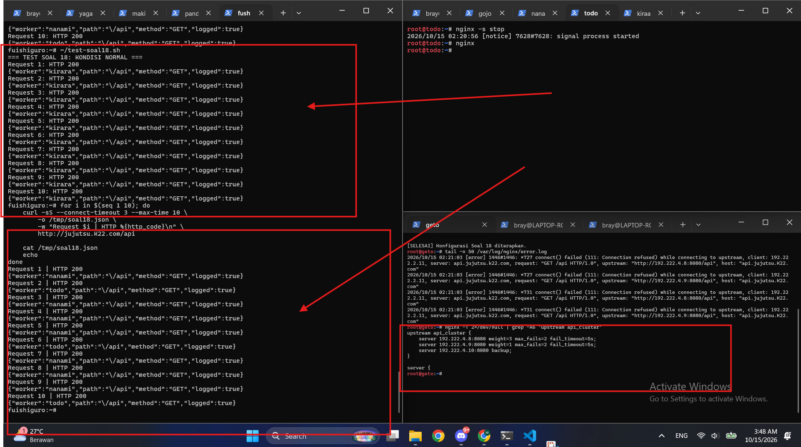

Berdasarkan hasil pengujian pada screenshot, Geto berhasil mengalihkan request ke Kirara ketika koneksi menuju Nanami dan Todo ditolak. Sepuluh request yang ditampilkan pada kondisi gangguan memperoleh HTTP 200 dengan identitas worker `kirara`. Setelah worker utama diaktifkan kembali, respons kembali dilayani oleh Nanami dan Todo.

---

> 19. Gojo bertugas mengoptimalkan layanan web sekaligus membatasi request berlebihan. Konfigurasikan Nginx Proxy Caching untuk halaman web frontend dengan masa berlaku cache 10 menit dan tambahkan header X-Cache-Status. Terapkan rate limiting pada path /api dengan batas 10 request per detik per IP klien. Buktikan bahwa request ke halaman web yang memenuhi syarat cache menghasilkan status MISS pada akses awal dan HIT pada akses berikutnya. Uji rate limiting secara terpisah dengan mengirimkan request beruntun ke /api, kemudian catat status respons yang dihasilkan ketika batas terlampaui.

Disini, kami melakukan konfigurasi Nginx pada node Gojo untuk mengoptimalkan akses layanan web melalui mekanisme *Proxy Caching* sekaligus membatasi request berlebihan menuju layanan API menggunakan *Rate Limiting*. Proxy caching diterapkan pada halaman frontend dengan masa berlaku cache selama 10 menit dan header `X-Cache-Status` untuk menunjukkan status cache setiap request. Sementara itu, rate limiting diterapkan pada path `/api` dengan batas 10 request per detik berdasarkan alamat IP klien. Pengujian dilakukan secara terpisah dari node Fushiguro untuk memeriksa status cache pada halaman frontend serta respons HTTP ketika batas request API terlampaui.

**1. Konfigurasi Proxy Caching dan Rate Limiting pada Gojo**

Alur konfigurasi pada Gojo adalah sebagai berikut:

1. **Pencadangan Konfigurasi Nginx**

   Script `setup-soal19-gojo.sh` menggunakan konfigurasi `/etc/nginx/sites-available/soal16-public-gateway` sebagai dasar konfigurasi. Sebelum melakukan perubahan, script mencadangkan konfigurasi tersebut dan file tambahan Soal 19 apabila sudah tersedia. Langkah ini dilakukan agar konfigurasi sebelumnya tetap dapat dipulihkan jika diperlukan.

2. **Konfigurasi Proxy Cache**

   Script membuat konfigurasi tambahan `/etc/nginx/conf.d/soal19-zones.conf` untuk mendefinisikan lokasi penyimpanan cache beserta zona cache yang digunakan oleh Nginx.

   Konfigurasi yang diterapkan adalah:

   ```nginx
   proxy_cache_path /var/cache/nginx/soal19
       levels=1:2
       keys_zone=frontend_cache:10m
       max_size=100m
       inactive=10m
       use_temp_path=off;
   ```

   Parameter `proxy_cache_path` menentukan direktori penyimpanan cache pada `/var/cache/nginx/soal19`. Parameter `keys_zone=frontend_cache:10m` menyediakan zona memori untuk menyimpan metadata cache, sedangkan `max_size=100m` membatasi ukuran cache hingga 100 MB. Parameter `inactive=10m` menentukan bahwa data cache yang tidak diakses selama 10 menit dapat dihapus.

3. **Penerapan Cache pada Halaman Frontend**

   Script memperbarui blok `location /` pada virtual host Gojo dengan menambahkan konfigurasi berikut:

   ```nginx
   proxy_cache frontend_cache;
   proxy_cache_key "$scheme$proxy_host$request_uri";
   proxy_cache_valid 200 10m;
   proxy_cache_methods GET HEAD;
   proxy_cache_lock on;
   add_header X-Cache-Status $upstream_cache_status always;
   ```

   Parameter `proxy_cache frontend_cache` mengaktifkan cache pada halaman frontend. Sementara itu, `proxy_cache_valid 200 10m` menentukan bahwa respons HTTP 200 disimpan selama 10 menit. Header `X-Cache-Status` ditambahkan agar klien dapat mengetahui apakah respons diperoleh dari cache atau memerlukan pengambilan data dari backend.

4. **Konfigurasi Rate Limiting pada API**

   Script mendefinisikan zona pembatasan request berdasarkan alamat IP klien menggunakan konfigurasi berikut:

   ```nginx
   limit_req_zone $binary_remote_addr
       zone=api_limit:10m
       rate=10r/s;
   ```

   Parameter `$binary_remote_addr` digunakan sebagai identitas klien, `zone=api_limit:10m` menyediakan ruang memori untuk menyimpan status pembatasan request, dan `rate=10r/s` menetapkan batas rata-rata 10 request per detik untuk setiap IP klien.

   Selanjutnya, pembatasan diterapkan pada lokasi `/api` dan `/api/` menggunakan konfigurasi berikut:

   ```nginx
   limit_req zone=api_limit burst=10 nodelay;
   limit_req_status 429;
   ```

   Parameter `burst=10` mengizinkan sejumlah request tambahan dalam antrean burst, sedangkan `nodelay` membuat request yang masih berada dalam batas burst diproses tanpa penundaan. Request yang melampaui batas yang diizinkan akan ditolak dengan kode HTTP 429 Too Many Requests.

5. **Validasi dan Aktivasi Konfigurasi**

   Setelah konfigurasi proxy caching dan rate limiting ditambahkan, script menjalankan `nginx -t` untuk memeriksa sintaks konfigurasi. Apabila validasi berhasil, Nginx dimuat ulang menggunakan `nginx -s reload`. Script juga menampilkan bagian konfigurasi zona cache dan rate limit untuk memastikan keduanya telah diterapkan.

Script yang digunakan adalah [setup-soal19-gojo.sh](nodes/switch1/gojo/setup-soal19-gojo.sh).

**2. Pengujian Proxy Caching dari Fushiguro**

Setelah konfigurasi caching diterapkan pada Gojo, pengujian dilakukan dari node Fushiguro menggunakan script `test-soal19-cache.sh`. Script mengirimkan tiga request secara berurutan ke `http://jujutsu.K22.com/`, kemudian mencatat kode status HTTP, nilai header `X-Cache-Status`, dan sebagian isi respons.

Alur pengujian adalah sebagai berikut:

1. **Pengujian Request Pertama**

   Request pertama dikirimkan ke halaman frontend melalui domain `jujutsu.K22.com`. Hasil pengujian menunjukkan kode status HTTP 200 OK dengan header `X-Cache-Status: MISS`. Status tersebut menunjukkan bahwa respons belum tersedia pada cache sehingga Nginx mengambil respons dari backend frontend.

2. **Pengujian Request Kedua**

   Request kedua dikirimkan ke URL yang sama. Hasil pengujian menunjukkan kode status HTTP 200 OK dengan header `X-Cache-Status: HIT`. Status ini menunjukkan bahwa respons berhasil diperoleh dari cache yang sebelumnya telah disimpan oleh Nginx.

3. **Pengujian Request Ketiga**

   Request ketiga kembali menghasilkan HTTP 200 OK dengan header `X-Cache-Status: HIT`. Hasil tersebut menunjukkan bahwa respons yang sama masih tersedia pada cache dan dapat digunakan kembali tanpa harus mengambil respons baru dari backend.

Ketiga request menampilkan halaman frontend dengan hostname `maki`. Dengan demikian, hasil pengujian menunjukkan bahwa respons dari backend dapat disimpan dan digunakan kembali melalui mekanisme proxy caching.

Script pengujian yang digunakan adalah [test-soal19-cache.sh](nodes/switch2/switch3/fushiguro/test-soal19-cache.sh).

**3. Pengujian Rate Limiting pada Endpoint API**

Pengujian rate limiting dilakukan secara terpisah menggunakan script `test-soal19-rate.sh`. Script mengirimkan 50 request secara berurutan ke `http://jujutsu.K22.com/api`, kemudian mencatat kode status HTTP setiap request ke file `/tmp/soal19-rate-results.txt`.

Alur pengujian adalah sebagai berikut:

1. **Pengiriman Request Berulang**

   Script mengirimkan 50 request ke endpoint `/api` menggunakan `curl`. Setiap request memiliki batas waktu koneksi tiga detik dan batas waktu total sepuluh detik. Kode status HTTP dari setiap respons kemudian dicatat untuk keperluan rekapitulasi.

2. **Pemeriksaan Respons HTTP**

   Respons yang diterima dikelompokkan berdasarkan kode status HTTP. Status 200 menunjukkan request yang berhasil diproses, sedangkan status 429 menunjukkan request yang ditolak oleh kebijakan rate limiting. Status 502 dan 000 juga dihitung secara terpisah untuk mengidentifikasi kegagalan gateway maupun kegagalan memperoleh respons HTTP.

3. **Rekapitulasi Hasil Pengujian**

   Berdasarkan hasil pengujian pada terminal Fushiguro, diperoleh hasil sebagai berikut:

   | Kode status | Jumlah request |
   |---|---:|
   | HTTP 200 | 15 |
   | HTTP 429 | 35 |
   | HTTP 502 | 0 |
   | HTTP 000 | 0 |
   | **Total** | **50** |

   Hasil tersebut menunjukkan bahwa dari 50 request yang dikirimkan, sebanyak 15 request memperoleh respons HTTP 200 dan 35 request ditolak dengan HTTP 429. Tidak terdapat respons HTTP 502 maupun kegagalan memperoleh kode status HTTP.

Script pengujian yang digunakan adalah [test-soal19-rate.sh](nodes/switch2/switch3/fushiguro/test-soal19-rate.sh).

**Hasilnya:**

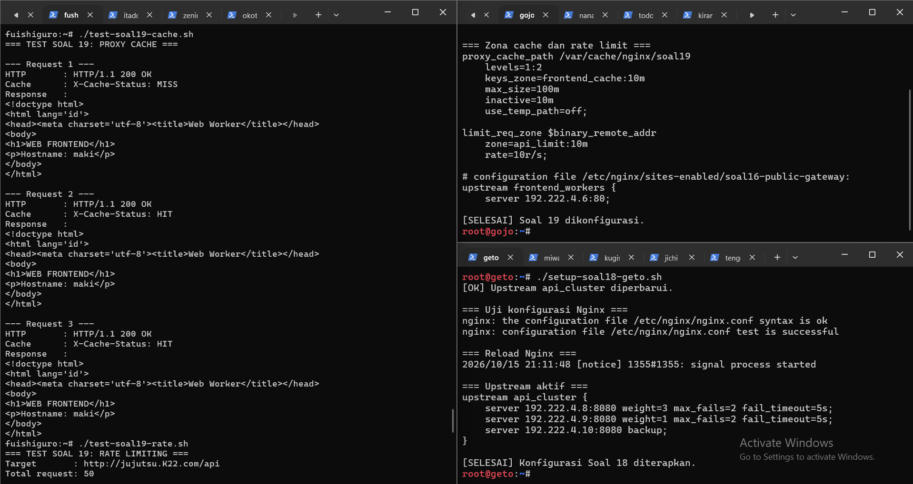

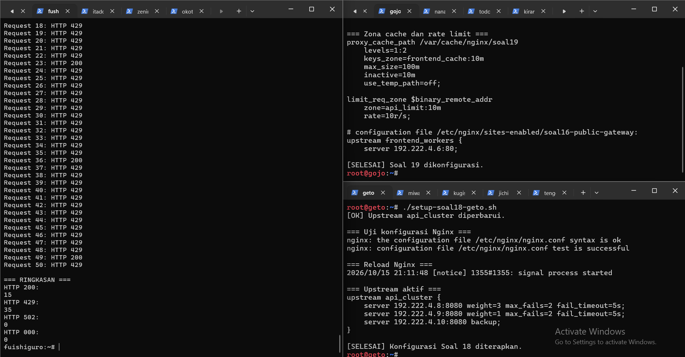

Berdasarkan hasil pengujian proxy caching, request pertama menghasilkan status `MISS`, sedangkan request kedua dan ketiga menghasilkan status `HIT`. Hasil tersebut menunjukkan bahwa mekanisme cache pada Gojo berfungsi sesuai konfigurasi untuk respons frontend yang memenuhi syarat cache.

Pada pengujian rate limiting, 35 dari 50 request memperoleh HTTP 429, sedangkan 15 request memperoleh HTTP 200. Tidak terdapat respons HTTP 502 maupun kegagalan koneksi yang ditandai dengan kode 000. Hasil ini menunjukkan bahwa aturan pembatasan request telah aktif dan mampu menolak sebagian request beruntun yang melampaui batas yang diizinkan.

---

>20. Sebelum Curtain di Shibuya resmi dibuka, Kusakabe memimpin audit untuk menguji kapasitas layanan. Dari terminal kusakabe, jalankan benchmark menggunakan Apache Benchmark dengan parameter `-n 600 -c 30` menuju `http://jujutsu.<xxxx>.com/`. Catat Requests per Second (RPS), latensi, dan jumlah request yang gagal. Lakukan pengujian tambahan pada endpoint `/api` untuk mengamati efek rate limiting. Bandingkan hasil pengujian baseline dengan hasil ketika rate limiting aktif, serta gunakan access log gojo untuk membedakan kegagalan aplikasi, koneksi, dan request yang ditolak oleh kebijakan rate limit.

Disini, kami melakukan pengujian performa layanan web dan API melalui terminal Kusakabe menggunakan Apache Benchmark (`ab`). Pengujian dilakukan dalam dua kondisi, yaitu **baseline ketika rate limiting tidak aktif** dan **ketika rate limiting aktif**. Setiap pengujian menggunakan parameter `-n 600 -c 30`, yang berarti mengirimkan total 600 request dengan 30 koneksi konkuren. Hasil yang diamati meliputi Requests per Second (RPS), waktu respons, jumlah request gagal, serta status HTTP yang tercatat pada access log Gojo.

**1. Persiapan Apache Benchmark pada Kusakabe**

Sebelum melakukan benchmark, Apache Benchmark dipastikan tersedia pada terminal Kusakabe. Perangkat pengujian menggunakan Apache Benchmark untuk mengirimkan request secara bersamaan ke layanan frontend dan endpoint API melalui domain `jujutsu.K22.com`.

Pengujian dilakukan terhadap dua endpoint berikut:

- **Frontend:** `http://jujutsu.K22.com/`
- **API:** `http://jujutsu.K22.com/api`

Parameter yang digunakan:

| Parameter | Keterangan |
|---|---|
| `-n 600` | Total request yang dikirim sebanyak 600 |
| `-c 30` | Maksimal 30 request aktif secara konkuren |
| `-l` | Mengizinkan panjang respons yang berbeda selama pengujian |

**2. Pengujian Baseline Tanpa Rate Limiting**

Pada tahap pertama, rate limiting dinonaktifkan sementara untuk mendapatkan hasil pembanding. Kusakabe kemudian menjalankan benchmark pada frontend dan endpoint `/api`. Hasil pengujian disimpan pada direktori `/root/soal20-baseline/`.

Hasil benchmark baseline:

| Endpoint | Request selesai | Request gagal | RPS | Rata-rata waktu per request |
|---|---:|---:|---:|---:|
| Frontend `/` | 600 | 0 | 7.174,37 | 4,182 ms |
| API `/api` | 600 | 0 | 865,16 | 34,676 ms |

Pada pengujian frontend, seluruh 600 request berhasil diselesaikan tanpa kegagalan yang dilaporkan Apache Benchmark. Layanan menghasilkan throughput sebesar **7.174,37 request per detik**, dengan rata-rata waktu per request sebesar **4,182 ms**.

Sementara itu, endpoint `/api` menghasilkan **865,16 request per detik** dengan rata-rata waktu per request sebesar **34,676 ms**. Pengujian tambahan menggunakan `curl` juga menunjukkan bahwa 600 request API pada kondisi baseline memperoleh status HTTP `200`.

Hasil ini menjadi acuan untuk melihat perubahan respons layanan ketika kebijakan rate limiting diterapkan.

**3. Pengujian dengan Rate Limiting Aktif**

Setelah pengujian baseline selesai, rate limiting pada Gojo diaktifkan kembali. Konfigurasi Nginx menggunakan zona pembatasan `api_limit`, dengan batas 10 request per detik per IP serta toleransi burst sebanyak 10 request.

Konfigurasi yang digunakan pada endpoint API:

```nginx
location = /api {
    limit_req zone=api_limit burst=10 nodelay;
    limit_req_status 429;

    proxy_pass http://api_gateway;
    proxy_set_header Host api.jujutsu.K22.com;
    proxy_set_header X-Real-IP $remote_addr;
    proxy_set_header X-Forwarded-For $remote_addr;
    proxy_set_header X-Forwarded-Proto $scheme;
}

location ^~ /api/ {
    limit_req zone=api_limit burst=10 nodelay;
    limit_req_status 429;

    proxy_pass http://api_gateway;
    proxy_set_header Host api.jujutsu.K22.com;
    proxy_set_header X-Real-IP $remote_addr;
    proxy_set_header X-Forwarded-For $remote_addr;
    proxy_set_header X-Forwarded-Proto $scheme;
}
```

Parameter `limit_req` membatasi laju request berdasarkan IP klien. Parameter `burst=10` memberikan toleransi terhadap lonjakan request, sedangkan `nodelay` membuat request yang masih berada dalam kapasitas burst diproses tanpa penundaan antrean. Ketika batas kebijakan terlampaui, Nginx mengembalikan status HTTP `429 Too Many Requests`.

Setelah konfigurasi diterapkan, konfigurasi Nginx diperiksa dan layanan dimuat ulang. Kusakabe kemudian mengulangi benchmark dengan parameter yang sama. Hasil pengujian disimpan pada direktori `/root/soal20-rate-limit/`.

Hasil benchmark setelah rate limiting aktif:

| Endpoint | Request selesai | Non-2xx | RPS | Rata-rata waktu per request |
|---|---:|---:|---:|---:|
| Frontend `/` | 600 | 0 | 7.765,08 | 3,863 ms |
| API `/api` | 600 | 589 | 6.815,32 | 4,402 ms |

Pada frontend, seluruh request tetap berhasil diselesaikan. RPS meningkat dari 7.174,37 menjadi 7.765,08, sementara rata-rata waktu per request turun dari 4,182 ms menjadi 3,863 ms.

Pada endpoint `/api`, Apache Benchmark mencatat 589 respons non-2xx. Pengujian status HTTP secara terpisah menunjukkan hasil **545 request berstatus `429` dan 55 request berstatus `200`**. Dengan demikian, sebagian besar request API ditolak oleh kebijakan rate limiting.

RPS API yang terlihat lebih tinggi setelah rate limiting aktif tidak berarti kapasitas pemrosesan API meningkat. Sebagian besar request ditolak dengan cepat oleh Nginx sehingga tidak seluruhnya diteruskan untuk diproses oleh backend.

**4. Analisis Access Log pada Gojo**

Untuk membedakan jenis kegagalan, access log dan error log Nginx pada Gojo diperiksa. Access log digunakan untuk melihat status HTTP yang dikembalikan, sedangkan error log membantu mengidentifikasi penyebab gangguan di sisi proxy atau upstream.

Pemeriksaan log dapat dilakukan menggunakan perintah berikut:

```bash
# Memeriksa request dengan status 502
grep ' 502 ' /var/log/nginx/access.log | tail -n 20

# Memeriksa error upstream, kegagalan koneksi,
# timeout, dan pesan terkait status 502
grep -E 'upstream|connect\(\) failed|timed out|502' \
    /var/log/nginx/error.log | tail -n 50
```

Berdasarkan rekap status log yang diperoleh selama pengujian, tercatat **4.369 respons HTTP 200, 1.169 respons HTTP 429, dan 10 respons HTTP 502**. Respons `429` berasal dari kebijakan rate limiting; error log juga menunjukkan pesan `limiting requests` pada zona `api_limit`.

Ketiga jenis kondisi perlu dibedakan:

- **HTTP 429 — Too Many Requests:** request ditolak karena melampaui kebijakan rate limiting.
- **HTTP 502 — Bad Gateway:** Gojo gagal memperoleh respons upstream yang valid. Penyebab pastinya perlu dikonfirmasi melalui detail error log, misalnya kegagalan koneksi atau respons upstream yang tidak valid.
- **Kegagalan koneksi atau timeout:** dapat terlihat sebagai kegagalan transportasi pada hasil benchmark atau pesan koneksi dan timeout pada error log. Kondisi ini tidak sama dengan penolakan `429`.

Status `429` bukan bukti bahwa aplikasi backend mengalami kegagalan. Sebaliknya, status `502` tidak boleh langsung dianggap sebagai dampak rate limiting tanpa memeriksa log yang berkaitan dengan upstream.

Pengujian pada kondisi `baseline` dengan yang sudah dipasangi `rate limit` dilakukan dengan script yang sama, yaitu: [test-soal20.sh](nodes/switch4/switch5/kusakabe/test-soal20.sh)

**Hasilnya:**

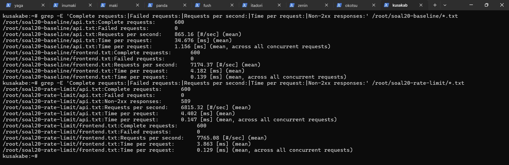

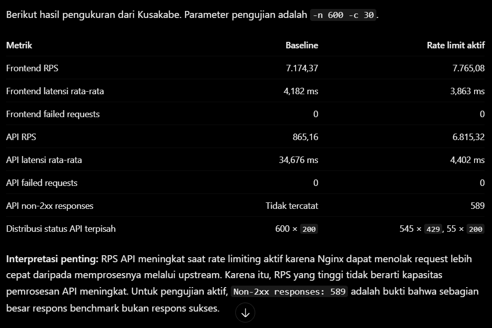

Berdasarkan hasil pengujian, Apache Benchmark berhasil digunakan untuk membandingkan performa frontend dan API dalam kondisi baseline serta ketika rate limiting aktif. Frontend menyelesaikan seluruh 600 request tanpa kegagalan yang dilaporkan pada kedua pengujian. Sementara itu, pada endpoint `/api`, aktivasi rate limiting menyebabkan mayoritas request menerima status HTTP `429`, sesuai dengan fungsi pembatasan request berdasarkan IP klien.

Pemeriksaan access log Gojo juga memperlihatkan adanya respons `200`, `429`, dan `502`. Status tersebut perlu dianalisis secara terpisah untuk membedakan request yang berhasil, request yang ditolak oleh kebijakan keamanan, dan masalah komunikasi dengan upstream. Dengan demikian, pengujian ini menunjukkan bahwa benchmark perlu dievaluasi bersama status HTTP dan log Nginx agar hasil throughput tidak disalahartikan sebagai ukuran keberhasilan pemrosesan aplikasi semata.

---